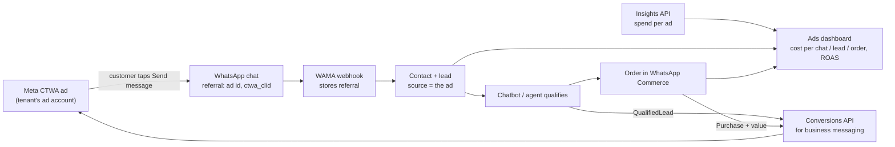

# Ads management plan: Meta and Google Ads for every tenant

Prepared 31 October 2026. This is a proposal for discussion, not a commitment.

The idea: WAMA runs Meta and Google ads for each tenant. Mode A ("managed"): our team runs the ads and the tenant sees the results inside their own workspace. Mode B ("self-serve"): the tenant connects their own ad accounts and runs campaigns from the CRM.

The plan covers:

- how competitors handle ads;
- what Meta and Google require before we can build this;
- the account and billing model we recommend;
- how the feature fits this codebase;
- a phased roadmap.

> **How the research was done.** `developers.facebook.com` and `developers.google.com` could not be opened from the research environment, which blocks those hosts. Platform facts therefore come from search-engine extracts of the official pages and from secondary sources. Items marked **(confirm)** were reported but not checked against the live official page. Check them before relying on them. Section 11 lists all of them.

---

## 1. Summary

**What competitors do.** Most do **not** run ads for their customers, and most do not build ads inside their product either.

- **The common pattern:** the customer builds the ad in Meta Ads Manager (the official portal). The WhatsApp CRM then picks up the click-to-WhatsApp (CTWA) chats, tags them with the ad, and sends conversion events back to Meta. WATI, Gallabox, DoubleTick, Bik, Zoko, Gupshup and respond.io all work like this.
- **In-product ad builders:** in India, only **AiSensy** and **Interakt** have one, and only for Meta. Globally, **HubSpot** and **HighLevel** have one for Meta, Google and LinkedIn. HighLevel is the template for an agency serving many clients, each in its own sub-account.
- **Done-for-you:** no Indian WhatsApp CRM was found running ads as a managed service with live results in the client's workspace. None was found creating Google ads.

**What we recommend.** Build **WAMA Ads** in four phases. Click-to-WhatsApp comes first because it ties directly into our inbox, chatbots and WhatsApp Commerce. Google follows.

1. **Phase 0 — make the platform safe for ad accounts** (about 3 weeks)
   - Fix the critical items from the October 2026 security review first; it is shared privately with the team, not in this repository. We should not ask Meta or Google for ad-account access, or hold tenants' ad tokens, until those fixes are live.
   - Add an encrypted credential store, a real job scheduler and server-side feature flags.
   - Start capturing click-to-WhatsApp referral data now. The webhook currently discards it, so attribution for tenants who already run these ads is lost.
2. **Phase 1 — Measure** (about 6 weeks)
   - Connect accounts in both modes.
   - Show spend, cost per chat, cost per lead and ROAS for each tenant.
   - Bring Meta lead-form and Google lead-form leads into the CRM.
   - Show ad attribution in the inbox.
   - Give our team an "agency desk" for managed tenants.
   - Tenants still build ads in Ads Manager, as most competitors do, but we already show the full funnel.
3. **Phase 2 — Launch** (about 8 weeks)
   - A click-to-WhatsApp ad builder inside WAMA.
   - Approvals for managed mode: the tenant approves creative and budget.
   - Conversion events back to Meta (qualified lead, purchase from WhatsApp Commerce orders).
   - Sync CRM segments to Meta audiences.
4. **Phase 3 — Google and automation** (about 9 weeks)
   - Search and Performance Max campaigns with WhatsApp message assets, and Google lead forms.
   - Conversions sent through Google's Data Manager API.
   - AI-written ad copy, automatic budget and pause rules, and optional prepaid ad wallets.

**Operating model.** In managed mode, the **tenant owns the ad account and the Facebook Page and pays Meta or Google directly**. Our agency business gets partner access, and we charge a management fee.

- Use ad accounts that we own only as an exception, for small tenants, with a prepaid wallet.
- Never put two tenants in one ad account.
- Run the agency operation from a **separate Meta business portfolio**, not the one that holds our WhatsApp Tech Provider app.

The reason for these rules: in August 2026 Meta disabled the Business Managers of the Indian agency Blink Digital, reportedly cutting off about 9,000 client ad accounts in one action.

---

## 2. How competitors do it

### 2.1 Comparison

| Product | Ads inside the product | Account and billing | Notes |
|---|---|---|---|
| **AiSensy** | Full Meta ad builder: CTWA, website and lead-form ads, plus WhatsApp Status ads (recent). Also AI creatives, reporting, an "AI Ads Agent", and conversion events from chatbot flows. | Customer's own Meta ad account. Spend is paid with prepaid **ad credits bought inside AiSensy** (UPI, card or wallet). Ad credits are separate from WhatsApp message credits. | ₹1,000 free ad credits (July 2026 offer; older pages say ₹500). WhatsApp "CTWA Partner of the Year 2024". |
| **Interakt** | CTWA ad launcher: copy, creative, targeting and budget are set inside Interakt. ROAS dashboard and conversion events. | Customer's own Meta ad account, which Interakt's guide says it **creates in the background if the customer has none**. Spend is charged to that account's payment method. | Its Conversions API guide still says ads must be created in Ads Manager to send conversion events. |
| **WATI** | No ad builder; ads are made in Ads Manager. Tracks CTWA, Google click-to-message and TikTok messaging ads, and sends conversion events. | Customer's own. | Conversion tracking is on higher plans or an add-on. |
| **Gallabox** | Analytics only: daily spend and results, the ad ID on each conversation, and conversion events with order value. | Customer's own. | |
| **DoubleTick** | Ads are built in Meta; CTWA leads are captured. Conversion events are a paid add-on; audiences are exported by hand. | Customer's own. | |
| **Gupshup** | A "CTWA Ads Manager" that links chatbot journeys to campaigns and reports attribution. Ads are still created in Ads Manager. | Customer's own; enterprise sales. | Also sold to agencies and resellers. |
| **Bik.ai, Zoko, LimeChat** | CTWA journeys and ROAS dashboards (Bik), a list of Ads Manager campaigns (Zoko), marketing pages only (LimeChat). | Customer's own. | |
| **respond.io** | CTWA chats are tagged automatically, workflows can start from an ad, and conversion events are sent. | Customer's own. | |
| **HubSpot** | Creates Meta lead and traffic ads, LinkedIn ads and Google Search ads. Syncs leads and audiences, and sends Meta and Google conversions. No CTWA. | Customer's own accounts. | |
| **HighLevel** | Ad manager for Meta, Google Search and LinkedIn. Agency model with **one sub-account per client**. | Each sub-account has its own ad account, usually connected through the agency's partner access. Meta or Google bill that account. | Ad-spend rebilling comes from add-ons such as Plai and UpHex. |
| **Zoho, LeadSquared, Kommo** | Lead-form sync, Google offline conversions (Zoho), and some conversion events. | Customer's own. | |
| **Meta itself** | The WhatsApp Business app's "Advertise" button, Meta Business Suite, Ads Manager, and ads in WhatsApp Status (2025). | The advertiser's own ad account. | The baseline every competitor builds on. |
| **Google itself** | Performance Max (Smart campaigns are being folded in), WhatsApp message assets in India, and lead forms with webhooks. | The advertiser's own account, or billing through a manager account (MCC). | |

Sources are listed at the end of this document. Most competitor facts come from the vendors' own help and marketing pages and were not independently tested.

### 2.2 Five patterns

1. **Ads built in Ads Manager, tracked in the inbox.** This is the majority. The CRM reads the CTWA referral data and reports on it.
2. **Conversion events back to Meta, sold as an upsell.** Meta receives purchases and qualified leads from the chat, so it can find more people like the buyers. WATI, DoubleTick and AiSensy charge extra for this.
3. **An ad builder inside the product, for non-marketers.** AiSensy and Interakt (Meta only); HubSpot and HighLevel (several ad networks).
4. **Lead and audience sync only.** LeadSquared, Zoho, Kommo, Pabbly, Klaviyo and Shopify.
5. **Agency platform with sub-accounts.** HighLevel. Ad-spend rebilling is left to add-ons.

### 2.3 Gaps a WhatsApp-first Indian CRM can own

1. **Done-for-you ads with live results in the client's own workspace.** No Indian player offers this. Our managed mode is exactly this.
2. **Google ads inside a WhatsApp CRM.** Google supports WhatsApp message assets and lead-form webhooks in India, but no Indian WhatsApp platform was found building Google campaigns.
3. **Revenue-based ROAS at ad level.** Combine Meta spend, Google spend and the revenue from orders placed in WhatsApp chats. We already have WhatsApp Commerce orders, which most competitors don't.
4. **Automatic segment-to-audience sync**, for example "chatted but didn't buy" pushed to Meta and Google, with consent tracking.
5. **One INR invoice with GST** covering ad spend plus our fee, with spend caps per tenant. This applies only if we choose to re-bill (see section 3.3).

---

## 3. The two modes in practice

The same data model serves both modes. Each ad account belongs to **exactly one tenant**, and each connection records **who operates it**: `tenant` or `platform`. Because of that, the results of managed campaigns appear in the tenant's own workspace automatically.

### 3.1 Mode A — managed: our team runs the tenant's ads

**Meta — recommended default (A1): the tenant owns, we operate.**

1. The tenant has, or creates, a business portfolio, a Facebook Page and an ad account with their own payment method.
2. The tenant shares the **ad account** (tasks: advertise and analyse) and the **Page** (advertise, plus Leads Access) with our agency business portfolio as a partner.
   - This is done under Business settings > Partners.
   - We can also send the request through the API (`/{our_business}/client_ad_accounts`), and the tenant approves it.
3. A system user in our agency portfolio runs campaigns through the Marketing API. The tenant's WhatsApp number must be linked to their Page for click-to-WhatsApp ads.
4. **Billing:** Meta charges the tenant's payment method and issues a GST invoice in the tenant's name. We invoice only our management fee.

**Meta — exception (A2): we own and pay.**

- We create an ad account per tenant in our agency portfolio (`POST /{business_id}/adaccount`), marked as advertising on behalf of the tenant's business.
- The tenant still grants us access to their Page.
- We pay Meta and re-bill the tenant for spend plus fee from a **prepaid wallet**, so we never carry their unpaid spend.
- Downsides:
  - Meta invoices us. We re-invoice the tenant, and GST applies to spend plus fee unless the strict "pure agent" conditions are met; a CA must confirm.
  - New businesses start with **one ad account** until a payment is confirmed. The limit grows with spend.
  - Meta says it "may hold you responsible" for violations in ads you place for others.

**Google — recommended default (G1): link the tenant's account.**

- We send a link request from our manager account (MCC) to the tenant's Google Ads account (`CustomerClientLink`, status PENDING), and the tenant accepts it.
- The tenant keeps their own payment method; India's RBI e-mandate rules limit automatic card charges.

**Google — exception (G2): we create the account.**

- We create a client account under our MCC (`CreateCustomerClient`, which needs Basic access or higher).
- Billing through the API works only for monthly-invoicing accounts. Otherwise the tenant sets up payment in the Google Ads interface.

**What managed mode requires of us, every time:**

- **A signed authorisation from the tenant**, stored in `managed_ads_agreements` (section 6). It covers scope, monthly spend cap, fee, creative approval and who owns the accounts.
- **Google's Third-party policy**, which applies when we manage accounts for others:
  - disclose our fees in writing before the first purchase and on invoices;
  - report the exact Google cost, clicks and impressions at least monthly;
  - give tenants their customer IDs on request;
  - keep one account per advertiser.
- **An audit trail of every change we make** in the tenant's account, visible to the tenant.

### 3.2 Mode B — self-serve: the tenant runs their own ads in WAMA

- **Meta:** the tenant clicks *Connect Meta Ads*, and Facebook Login for Business opens with a dedicated configuration. As a Tech Provider we receive a business-integration system-user token that covers only the assets the tenant selected. The tenant then picks the ad account, Page and WhatsApp number.
- **Google:** the tenant signs in with Google using the `adwords` scope. We list the accounts they can access and they pick one.
- **Billing:** the tenant's own payment method. We charge a subscription add-on.

### 3.3 Choosing the billing model for managed mode

| | A1/G1: tenant owns, tenant pays (recommended) | A2/G2: we own, we pay, we re-bill |
|---|---|---|
| Our cash and credit risk | None | We front ad spend, so a prepaid wallet is needed |
| GST and accounting | We invoice only our fee | We re-invoice spend plus fee; a CA must confirm "pure agent" treatment |
| Platform risk | A tenant's violation mostly stays in their account | Violations count against our business; Blink Digital shows the worst case |
| Ad account limits | None for us | Start at 1, grow with spend |
| Tenant onboarding effort | Higher: they need a business portfolio, ad account and payment method | Lower |
| Tenant keeps data and history if they leave | Yes | Only if we hand the accounts over |

**Recommendation:** A1/G1 by default. Offer A2/G2 only to small tenants who cannot set up their own account, with a prepaid wallet, a spend cap and a written agreement.

---

## 4. What Meta and Google require

### 4.1 Meta

| Requirement | What it means for us |
|---|---|
| **Permissions** | **To run ads:** `ads_management`, `ads_read`, `business_management`, `pages_show_list`, `pages_read_engagement`.<br>**For CTWA ads and lead forms:** `pages_manage_ads`.<br>**For lead webhooks:** `leads_retrieval`, `pages_manage_metadata`.<br>**For WhatsApp conversion events:** `whatsapp_business_manage_events`. It is reported to be granted automatically once we hold Advanced `whatsapp_business_messaging` (confirm).<br>Our app currently requests none of the ads or Page permissions. |
| **Advanced access through App Review** | Required for ad accounts we don't own. This covers every tenant in both modes.<br>We must make a successful call for each permission within 30 days before submitting.<br>Review usually takes days, sometimes weeks. |
| **Business Verification and Tech Provider status** | Business Verification is required for advanced access (it can take up to about 14 business days).<br>Separate "Access Verification" for these permissions was reportedly retired in October 2026. Apps are now classed as Tech Providers when they request advanced permissions, but Meta's pages conflict (confirm). We are already a Tech Provider. |
| **Marketing API access tier** | On 4 May 2026 "Ads Management Standard Access" became the **Marketing API Access Tier**: Standard became *Limited* (the default) and Advanced became *Full*.<br>Full is needed for production rate limits and is granted through App Review. Meta's changelog describes at least 500 Marketing API calls in 15 days with under 15% errors as the auto-approval threshold. |
| **Rate limits** | Counted per ad account per hour and scaled by the number of active ads. Small tenants get small quotas, so batch and cache our insights requests. |
| **Tokens** | **Self-serve:** a business-integration system-user token, which does not expire by default; tenants can revoke it at any time.<br>**Managed:** a system user in our agency business portfolio. A system user only has roles on assets its own business owns or has been shared as a partner. |
| **Click-to-WhatsApp ads** | **Ad set:** `destination_type=WHATSAPP`, `optimization_goal=CONVERSATIONS`, and a `promoted_object` with the Page (and optionally the WhatsApp number).<br>**Campaign objectives:** reported as Engagement, Leads, Sales or Traffic, but Meta's own tables conflict on Leads and Sales (confirm). Test those in a sandbox first.<br>**Linking:** the WhatsApp number must be linked to the Page, and the token user needs the advertise task on that Page. |
| **Free messaging window** | Chats that start from a CTWA ad or a Page button open a free window, provided we reply within 24 hours. Since August 2026 the only charge inside it is for Meta Business Agent messages.<br>The window used to be 72 hours. Meta's pricing page now says it "may remain open for up to 7 days"; that is a maximum, and vendors report rollout dates between 28 September and 7 October 2026.<br>Since 1 October 2026, service messages beyond 1,000 a month per number are charged, and so are utility messages sent inside the 24-hour window. That makes the ad-driven free window more valuable. |
| **Ad attribution in webhooks** | Inbound messages from ads carry a `referral` object: `source_id` (the ad), `source_type`, `source_url`, `headline`, `body` and `ctwa_clid`.<br>`ctwa_clid` is missing for ads shown in WhatsApp Status.<br>**Our webhook currently ignores `referral`.** |
| **Conversion events for chats** | `POST /{dataset_id}/events` with `action_source=business_messaging`, `messaging_channel=whatsapp`, `user_data.ctwa_clid`, `event_name` (e.g. `LeadSubmitted`, `Purchase` with value and currency) and `event_time`.<br>The dataset is found through the WhatsApp Business Account. |
| **Lead Ads** | Subscribe each Page to `leadgen` with a Page token, then fetch each lead by ID.<br>If the Page restricts lead access, both our app and the token's user must be assigned in Leads Access Manager. |
| **Custom Audiences from CRM data** | SHA-256 hash phone numbers and emails after normalising them.<br>Each ad account must accept the Custom Audience terms.<br>Audiences flagged as suggesting prohibited information can no longer be used (since September 2025). |
| **API versions** | Graph and Marketing API **v26.0** came out on 29 July 2026; our code is on v25.0. |
| **Ad campaign structure** | Legacy Advantage+ Shopping and App campaign creation is blocked. Build on the unified Advantage+ structure.<br>Detailed-targeting exclusions are gone; use excluded custom audiences instead. |
| **India and special categories** | Securities and investment ads must name a SEBI-verified beneficiary and payer (since July 2025).<br>Credit, loan and insurance ads must target 18+.<br>Online gambling ads are not supported in India.<br>The special ad category fields must be sent on every campaign. |
| **India billing** | Meta sells in INR with GST and accepts card, UPI, netbanking and Paytm.<br>Adding funds manually turns an account into a permanently prepaid one.<br>Recurring card charges must follow RBI e-mandate rules. |
| **Embedded Signup** | v4 was released on 8 October 2025, and Meta has scheduled v2 and v3 for retirement (confirm the date). Our signup defaults to v4, so make sure `NEXT_PUBLIC_META_ES_VERSION` is not set to v2 or v3 in production.<br>v4 can onboard a business to the Cloud API, Marketing Messages, CTWA ads and conversion events in one flow, chosen in the Facebook Login for Business configuration. |

### 4.2 Google

| Requirement | What it means for us |
|---|---|
| **API access** | Developer tokens were retired on 9 September 2026. API access now belongs to the Google Cloud project that owns our OAuth client, and we apply on the Google Ads API page in Cloud Console.<br>**Access levels:**<br>• Test<br>• Explorer: 2,880 operations a day on real accounts; cannot create accounts, touch billing or manage users<br>• Basic: 15,000 operations a day<br>• Standard: unlimited, with RMF rules |
| **OAuth verification** | `adwords` is a sensitive scope. Allow about 10 business days for verification. We need a verified domain, privacy policy, terms and a demo video. |
| **Manager account (MCC)** | Needed for managed mode: link existing tenant accounts, or create new ones under the MCC. |
| **Required Minimum Functionality (RMF)** | Applies only to Standard access. Full-service tools must cover creation, management and reporting. Non-compliance fees can apply. Stay on Basic until we need more than 15,000 operations a day. |
| **Developer policy (August 2026)** | Bans "programmatic proxies": no wrapper API or MCP server that just re-exposes Google Ads, and no shared proxy serving many businesses to skip approval. Requires a dedicated Cloud project for each integration. Our in-app product is fine; don't publish a pass-through API for tenants. |
| **Third-party policy** | Managed mode only: fee disclosure, exact cost reporting, customer IDs on request, one account per advertiser. |
| **Conversions and Customer Match** | Integrations with no earlier usage must use the **Data Manager API**, not the Google Ads API: for Customer Match since 1 April 2026, and for offline click conversions and enhanced conversions for leads since 15 June 2026. That includes us.<br>Data Manager needs its own OAuth scope verification.<br>Customer Match *targeting* needs 90 days of history and more than USD 50,000 lifetime spend, so most small tenants can use lists only for observation and exclusion. |
| **Lead form webhooks** | Each form posts JSON to our URL with a secret `google_key`, a `lead_id` for de-duplication, and the user's fields. Google keeps leads for 60 days. |
| **Campaign types through the API** | Search, Display, Performance Max and Demand Gen can be created. New Smart campaigns can no longer be created through the API (since 23 September 2026). |
| **Billing** | Card or UPI billing is set up by the account owner in the Google Ads interface. API billing setup works only for monthly-invoicing accounts. |

---

## 5. What we build

### 5.1 The closed loop that makes WAMA different



### 5.2 Screens

**Tenant workspace: a new "Ads" menu item** (gated by plan and the `ads.view` permission)

- **Overview:** spend, chats started, leads, orders, revenue, cost per chat, cost per lead and ROAS, by day and by campaign. Meta and Google appear side by side.
- **Campaigns:**
  - Phase 1: synced list with status, budget and results.
  - Phase 2: create a click-to-WhatsApp campaign from templates such as "Get more WhatsApp enquiries" and "Promote catalog products". Also pause, resume and change budget.
- **Leads:** Meta lead-form and Google lead-form submissions. Each one creates or updates a contact and lead, assigns it, and can start a chatbot flow or send a WhatsApp template.
- **Audiences (Phase 2):** CRM segments synced to Meta audiences, and later Google Customer Match. Contacts without marketing consent are excluded automatically.
- **Connections:** connect Meta or Google (self-serve), or show "Managed by WAMA" with the agreement, fee and spend cap.
- **Approvals (managed mode):** the tenant approves new campaigns, creative and budget changes. Every change is logged.

**Inbox and CRM changes**

- The conversation header shows *"Came from ad: \<ad name\> (Meta)"*.
- The lead's `source` is filled automatically (`meta_ctwa`, `meta_lead_form`, `google_lead_form`, `google_message_asset`).
- A new Flow Builder trigger: **"Came from ad X"**. For example, send each ad's visitors to a chatbot that matches the offer.

**Platform: an "Agency desk" for our managed-ads team** (separate from Super Admin)

- Managed tenants with spend against their cap, pacing, and alerts: disapproved ads, cost-per-lead spikes, token problems, and the Page or WhatsApp number becoming unlinked.
- Create campaigns for a tenant, which go through the tenant's approval first.
- A monthly report per tenant. Google's policy requires one with cost, clicks and impressions.

---

## 6. How it fits this codebase

**What exists today:**

- **WhatsApp connection and webhooks:** Embedded Signup with Facebook Login for Business (v4), the Meta webhook at `app/api/webhooks/facebook/[orgIdAndSlug]/route.ts`, and Graph API v25.0.
- **Permissions and plan flags:** RBAC in `lib/rbac.ts`, and per-tenant `enable_*` flags on `organizations`.
- **Leads:** a `leads.source` free-text field.

**What doesn't exist:**

- No ads code, ads permissions or Page code.
- No background job runner. Campaign scheduling is a browser timer.
- No dedicated encrypted credential store. Ad tokens must not be added as more columns on `organizations` (see 6.2).
- No server-side feature entitlements. Today's beta gating lives in the dashboard menu and is keyed to org name or ID.

### 6.1 New tables

Every new table gets RLS enabled, policies that limit rows to members of the tenant, and **no access for the anon role**. Amounts are stored in minor units (paise or cents) with a currency code.

```sql
-- One row per connected Meta business / Google login used for a tenant.
create table ad_connections (
  id uuid primary key default gen_random_uuid(),
  organization_id uuid not null references organizations(id) on delete cascade,
  provider text not null check (provider in ('meta', 'google')),
  operated_by text not null check (operated_by in ('tenant', 'platform')),
  external_business_id text,            -- Meta business portfolio id / Google manager or login customer id
  credential_id uuid,                   -- reference into the encrypted credential store; never the token itself
  scopes text[] not null default '{}',
  status text not null default 'active' check (status in ('active', 'needs_reauth', 'revoked', 'error')),
  token_expires_at timestamptz,
  connected_by uuid references users(id),
  created_at timestamptz not null default now(),
  updated_at timestamptz not null default now()
);

-- An ad account belongs to exactly one tenant: the unique key stops two tenants sharing one.
create table ad_accounts (
  id uuid primary key default gen_random_uuid(),
  organization_id uuid not null references organizations(id) on delete cascade,
  connection_id uuid not null references ad_connections(id) on delete cascade,
  provider text not null check (provider in ('meta', 'google')),
  external_account_id text not null,    -- act_123... / 1234567890
  name text,
  currency text not null,
  timezone text,
  owner text not null check (owner in ('tenant', 'platform')),  -- who owns and pays (A1/G1 vs A2/G2)
  meta_page_id text,                    -- Page the ads run from
  whatsapp_phone_number_id text,        -- number linked to that Page, for click-to-WhatsApp ads
  status text not null default 'active',
  unique (provider, external_account_id)
);
```

Further tables:

| Table | Purpose | Key points |
|---|---|---|
| `ad_campaigns`, `ad_sets`, `ads` | Mirror of campaigns, ad sets/ad groups and ads, with status, budgets and creative JSON | `created_via` = `wama` or `external`; `created_by`; `approved_by` |
| `ad_insights_daily` | Daily results per campaign, ad set and ad | Unique on (account, level, external id, date). Spend, impressions, clicks, leads, chats started, purchases and purchase value. Re-pulled for 28 days because attribution changes after the fact |
| `ad_attributions` | Links a contact, conversation or lead to an ad | Source type (`ctwa`, `lead_form`, `gclid`, `message_asset`, `utm`), `ctwa_clid`/`gclid`, ad/campaign IDs, headline, first-touch time. Filled from the webhook `referral` |
| `ad_lead_events` | Raw lead-form submissions | Unique on (provider, external lead id). Personal data is minimised and encrypted; links to the contact and lead created; processing status |
| `ad_conversion_events` | Outbound events to Meta or Google | Event name, value, currency, event time, unique `dedup_key`, status, attempts, last error. Sent by the job runner |
| `ad_audiences` | Synced audiences | Source segment definition, consent basis, size, last sync |
| `ad_change_log` | Append-only record of every change we make to an ad account | Actor (tenant user, platform operator or system), action, before and after JSON, approval reference |
| `ad_approvals` | Approval requests in managed mode | Requested by, budget or creative change, status, decided by and when |
| `managed_ads_agreements` | One signed agreement per managed tenant | Fee type and value, monthly spend cap, billing model (A1/G1 or A2/G2), signed by and date, document link |
| `organization_features` | Server-enforced plan entitlements (e.g. `ads_self_serve`, `ads_managed`) | Replaces the client-side name/ID gating |
| `platform_ads_assignments` | Which agency-desk staff may operate which managed tenants | Least privilege; agency staff do not need Super Admin |

### 6.2 Credentials

- **Store** Meta system-user tokens, Google refresh tokens and lead-form webhook keys in **Supabase Vault (pgsodium)**, or encrypt them in the app with AES-256-GCM using a key kept outside the database.
- **Never** add them as new columns on `organizations`, and never send them to the browser.
- **Health check:** a daily job inspects each token (Meta `debug_token`, Google token refresh). It marks connections `needs_reauth` and notifies the tenant admin or the agency desk.

### 6.3 Background jobs

There is no scheduler today: broadcast campaigns only progress while someone has the Campaigns page open. Ads needs one too, so build a single job system and move broadcasts onto it as well.

- **Options:**
  - **Supabase `pg_cron` + `pgmq` + Edge Functions:** stays inside the stack we already use.
  - **Vercel Cron + Upstash QStash:** if we stay on Vercel functions.
  - Pick one.
- **Jobs:**

  | Job | Schedule | What it does |
  |---|---|---|
  | `ads.sync_insights` | Hourly for active accounts, daily for a 28-day backfill | Pulls spend and results |
  | `ads.process_lead` | On each webhook delivery | Processes a Meta `leadgen` or Google lead-form submission; idempotent on the lead ID |
  | `ads.reconcile_leads` | Daily | Re-reads recent leads from Meta and Google so none are missed |
  | `ads.send_conversion` | Continuously, with retries and backoff | Sends events to Meta or Google, de-duplicated by `dedup_key` |
  | `ads.check_tokens` | Daily | Runs the credential health check (6.2) |
  | `ads.pacing_alerts` | Hourly | Checks spend against caps and flags cost-per-result spikes |
  | `ads.monthly_report` | Monthly | Builds each managed tenant's report |

### 6.4 Endpoints and webhooks

| Route | Purpose |
|---|---|
| `POST /api/ads/connect/meta` | Exchange the Facebook Login for Business code. List the businesses, ad accounts, Pages and WhatsApp numbers the token can reach, then save the tenant's choice. |
| `GET /api/ads/connect/google/callback` | Google OAuth callback. List accessible customers and save the tenant's choice. |
| `POST /api/ads/managed/link` | Agency desk: request partner access to a tenant's Meta ad account and Page, or send a Google `CustomerClientLink`. |
| `GET /api/ads/insights` | Read data for the dashboard. |
| `GET/POST /api/ads/campaigns` | List campaigns; create or update them (Phase 2). |
| `POST /api/ads/approvals/:id` | Approve or reject a change in managed mode. |
| `GET/POST /api/ads/audiences` | List and sync audiences (Phase 2). |
| `POST /api/webhooks/google-leads/[formKey]` | Receive Google lead forms. Check `google_key` in constant time and de-duplicate on `lead_id`. |
| Existing Meta webhook | Add `leadgen` handling (Page subscription) and save `referral` on inbound messages. Process only events with a valid Meta signature. |

### 6.5 Permissions

- **Tenant permissions** in `lib/rbac.ts`:
  - `ads.view` — managers and above, and employees with see-all;
  - `ads.manage` — admins in self-serve mode;
  - `ads.approve` — admins, to approve managed-mode changes.
- **Platform staff:** a new `platform_ads_operator` role, limited to the tenants in `platform_ads_assignments`. They do not need full Super Admin rights.
- Every route checks the tenant's entitlement in `organization_features` on the server.

### 6.6 Privacy and consent (India DPDP Act)

- **Timeline:** the DPDP Rules were notified on 13–14 November 2025. Most duties (notice, consent, security safeguards, breach reporting) apply about 18 months later, around May 2027. Rules for consent managers may start around November 2026 (confirm against the Gazette).
- **Roles:** tenants decide why their customers' data is processed (they are the "data fiduciaries"); WAMA processes it for them. We need a data processing agreement with each tenant.
- **Audiences:** uploading a tenant's customer phone numbers to Meta or Google is a separate purpose that needs a lawful basis or consent. Add a per-contact marketing-consent flag, and exclude opted-out contacts from audiences and from WhatsApp marketing.
  - There is no opt-out (STOP) handling or suppression list yet, so this has to be built first.
- **Lead-form data:** minimise and encrypt personal data, and set how long it is kept.

---

## 7. Roadmap

Estimates assume 2 full-stack engineers, a part-time designer, and one ads specialist for managed operations from Phase 1. External approval times are outside our control, so start them in week 0.

| Phase | Weeks | Engineering | Approvals, legal and operations running in parallel |
|---|---|---|---|
| **0. Make it safe** | 0–3 | • Fix the critical items from the private security review<br>• Encrypted credential store<br>• Job runner<br>• `organization_features`<br>• Opt-out (STOP) handling and a suppression list<br>• **Save CTWA `referral` on every inbound message (1–2 days, do first)** | • Confirm Business Verification and Tech Provider Access Verification<br>• Add the ads and Page permissions to the Meta app<br>• Create the Google Cloud project and do brand verification<br>• Start Google OAuth verification<br>• Draft the managed-ads agreement and a DPA template<br>• Decide the billing model (section 3.3) and set up the separate agency business portfolio |
| **1. Measure** | 3–9 | • Meta connect, both modes (Login for Business config; partner-access flow)<br>• Google OAuth and MCC link<br>• Insights sync and the Ads overview<br>• Meta lead-form webhook into CRM leads<br>• Google lead-form webhook<br>• Ad attribution in the inbox and on leads<br>• Agency desk v1<br>• Monthly report | • Record App Review screencasts and submit Meta App Review for Advanced access<br>• Apply for Google Explorer, then Basic<br>• Pilot with 3–5 tenants (self-serve and managed) |
| **2. Launch** | 9–17 | • Click-to-WhatsApp campaign builder (Advantage+ structure), templates, budget caps, pause and resume<br>• Managed-mode approvals<br>• Conversion events for chats: `LeadSubmitted`, `QualifiedLead`, and `Purchase` from WhatsApp Commerce orders<br>• Audience sync with consent<br>• Alerts<br>• "Came from ad X" Flow Builder trigger | • Apply for Meta's Full Marketing API access tier once usage qualifies<br>• Pricing launch<br>• Optional free ad-credit promotion (AiSensy-style) |
| **3. Google and automation** | 17–26 | • Google Search and Performance Max builder with WhatsApp message assets<br>• Conversions and Customer Match through the Data Manager API<br>• AI ad copy and creative suggestions<br>• Automatic rules (pause poor ads, budget pacing)<br>• Optional prepaid wallet with GST invoicing (A2/G2) | • Data Manager API OAuth verification<br>• Google Standard access only above 15,000 operations a day (RMF applies)<br>• CA sign-off on re-billing |

**A faster start is possible:** the Phase 0 security fixes plus referral capture and a read-only Meta insights dashboard (weeks 0–5). It already matches what WATI and Gallabox offer, and it makes the Meta App Review screencasts easy to record.

---

## 8. Pricing options (to decide)

These follow market norms found in the research. Validate them with pilot tenants.

| Offer | Model | Comparable |
|---|---|---|
| **Ads Insights** (Phase 1) | Included in higher plans, or a small add-on | WATI and Gallabox put CTWA analytics on higher plans |
| **Self-serve Ads** (Phase 2) | Monthly add-on per workspace | HubSpot and HighLevel charge by subscription, not by spend |
| **Managed Ads** | Monthly retainer (Indian agencies quote roughly ₹10k–₹1.5L), or 10–20% of spend (global norm), with a minimum fee | Agencies; HighLevel resellers |
| **Ad credits promotion** | For example, ₹500–1,000 of free credit on a tenant's first CTWA campaign | AiSensy |

---

## 9. Risks

| Risk | Mitigation |
|---|---|
| Meta disables our business portfolio because of tenants' ads (as with Blink Digital, August 2026) | Tenant-owned ad accounts by default. A separate agency portfolio, away from the WhatsApp Tech Provider app. An approval step and policy pre-checks before launch. |
| App Review or OAuth verification is rejected or slow | Start in week 0. Submit with working flows and clear screencasts. Keep the security fixes done first. |
| Tenant doesn't pay spend we fronted | Avoid A2/G2. If used, prepaid wallet only. |
| Attribution is incomplete (Status ads don't send `ctwa_clid`; referral data can be sparse) | Report "attributed" and "unattributed" chats separately. Use Insights totals for spend. |
| Small tenants hit rate limits | Batch insights requests, cache, and sync incrementally. |
| Privacy complaints or DPDP breaches | Consent flags, opt-out handling, a DPA, encryption, a data-retention policy, and a breach-response runbook. |
| Ads go out for restricted categories (loans, securities, gambling) | Category questions in the campaign builder; block unsupported categories in India; human review in managed mode. |

---

## 10. Decisions needed from the team

1. **Billing model for managed mode:** A1/G1 (tenant pays Meta and Google, we charge a fee), A2/G2 (we pay and re-bill), or both.
2. **A separate Meta business portfolio for agency operations.** Recommended: yes.
3. **Scope of the first release:** recommended is Phase 0 plus Phase 1 (Meta first), with Google lead forms in Phase 1 and Google campaign creation in Phase 3.
4. **Who runs managed ads:** an in-house ads specialist, or a partner agency using our agency desk.
5. **Pricing** for Insights, Self-serve and Managed (section 8).
6. **Whether to apply for Meta's "onboard clients at scale" programme** (child business portfolios and a shared credit line). It matters only if we choose A2/G2 at volume.

---

## 11. Facts to confirm before relying on them

A second research pass cross-checked the important claims in this plan against several search queries per claim. Most were confirmed:

- the access-tier rename;
- Google's developer-token sunset and Data Manager API cutoffs;
- API versions and the Advantage+ Shopping/App deprecation;
- the 1 October 2026 WhatsApp pricing change;
- Google's third-party policy;
- Blink Digital;
- the competitor features.

Official pages were still only read through search extracts, so these remain open:

- **Free messaging window:** the exact start date of "up to 7 days" (vendors report 28 September to 7 October 2026), and whether Page CTA chats get it too.
- **Click-to-WhatsApp objectives:** which campaign objectives accept `destination_type=WHATSAPP` (Meta's pages conflict on Leads and Sales). Test in a sandbox.
- **Conversion events:** whether `whatsapp_business_manage_events` must be requested separately, and whether a WhatsApp event needs `page_id` or `whatsapp_business_account_id`.
- **Tech Provider "Access Verification":** reported as retired in October 2026, but Meta's pages conflict.
- **Embedded Signup:** the retirement date for v2 and v3.
- **Google billing:** whether consolidated billing is available to agencies in India, and the monthly-invoicing criteria.
- **Competitors:** how AiSensy settles prepaid ad credits with Meta. Competitor facts come from the vendors' own pages.
- **GST:** how re-billed ad spend is treated, and whether Meta India invoices state 18% explicitly. Get a CA's opinion.

---

## Sources

**Competitors**

- AiSensy:
  - [Ads Manager](https://aisensy.com/features/aisensy-meta-ads-manager)
  - [website and lead-form ads (Feb 2026)](https://news.aisensy.com/130915-introducing-meta-website-ads-and-lead-form-ads-in-aisensy-ads-manager)
  - [free ad credits](https://news.aisensy.com/152198-get-1-000-free-meta-ad-credits-with-aisensy)
  - [Conversions API with CTWA](https://wiki.aisensy.com/en/articles/11502783-how-to-use-meta-conversions-api-capi-in-click-to-whatsapp-ads)
  - [CTWA Partner of the Year](https://businessworld.in/article/aisensy-wins-ctwa-partner-of-the-year-2024-award-at-whatsapp-business-summit-534214)
- Interakt:
  - [CTWA ads](https://www.interakt.shop/click-to-whatsapp-ads/)
  - [setup](https://www.interakt.shop/resource-center/how-to-setup-ctwa-campaigns-using-interakt/)
  - [Conversions API](https://www.interakt.shop/resource-center/conversions-api)
- WATI:
  - [CTWA FAQ](https://support.wati.io/en/articles/11865651-general-faqs-ctwa)
  - [conversion tracking](https://support.wati.io/en/articles/11463598-how-to-track-ctwa-ad-conversions-in-wati)
  - [Google click-to-message](https://support.wati.io/en/articles/11462076-google-ctm-ads-everything-you-need-to-know)
- Gallabox:
  - [ad campaigns](https://docs.gallabox.com/whatsapp/ad-campaigns/overview)
  - [Conversions API](https://docs.gallabox.com/whatsapp/ad-campaigns/capi.md)
- DoubleTick:
  - [CTWA](https://learn.doubletick.io/click-to-whatsapp-ctwa/how-to-run-click-to-whatsapp-ctwa-ads-on-meta-and-connect-them-with-doubletick)
  - [Conversions API](https://learn.doubletick.io/conversion-api/conversions-api-on-doubletick-implementation-guide-step-by-step)
- Gupshup:
  - [launch](https://cxotoday.com/press-release/gupshup-launches-an-end-to-end-platform-for-ads-that-click-to-whatsapp-with-full-funnel-attribution-and-ai-powered-optimization/)
  - [docs](https://console-docs.gupshup.io/docs/creating-a-ctwa-ad-on-meta-ads-manager)
- Bik.ai: [CTWA](https://help.bik.ai/en/articles/8218601-ctwa-with-bik)
- Zoko: [connect Meta ads](https://zoko.io/learning-article/connect-your-meta-ads-to-zoko)
- LimeChat: [CTWA](https://limechat.ai/marketing/click-to-whatsapp-ads)
- respond.io: [Meta business accounts](https://respond.io/help/integrations/meta-business-accounts)
- HubSpot:
  - [manage Facebook ads](https://knowledge.hubspot.com/ads/manage-your-facebook-ad-campaigns-in-hubspot)
  - [lead ads](https://knowledge.hubspot.com/ads/create-facebook-and-linkedin-lead-ads-in-hubspot)
- HighLevel:
  - [Ad Manager overview](https://help.gohighlevel.com/support/solutions/articles/155000002433-overview-of-ad-manager)
  - [reselling](https://help.gohighlevel.com/support/solutions/articles/155000004261-enable-and-resell-ad-manager)
- Zoho: [Google Ads integration](https://help.zoho.com/portal/en/kb/crm/integrations/google/google-ads/articles/google-ads-crm-integration)
- Kommo: [Facebook ads](https://www.kommo.com/integrations/facebook-ads/)
- LeadSquared: [online ads](https://help.leadsquared.com/category/integrations-apps/online-ads/)

**Agencies and the market**

- Blink Digital:
  - [exchange4media](https://www.exchange4media.com/digital-news/blink-digital-sues-meta-for-over-rs-1000-crore-over-disabled-business-accounts-158462.html)
  - [Bar & Bench](https://www.barandbench.com/news/bombay-high-court-rejects-metas-plea-to-shift-blink-digitals-suit-to-california-notes-facebook-india-did-not-raise-objection)
- Meta, [onboard clients at scale](https://developers.facebook.com/documentation/business-sdk/common-scenarios/onboard-at-scale)
- Agency setup guide ([Leadsie](https://leadsie.com/blog/set-up-meta-business-manager-agencies))
- GST notes ([Tax Garden](https://taxgarden.in/blog/gst-income-tax-digital-marketing-agency-india-ay-2026-27); not legal advice)

**Meta**

- Access and authorisation:
  - [authorization](https://developers.facebook.com/documentation/ads-commerce/marketing-api/get-started/authorization)
  - [access tier update](https://developers.meta.com/blog/updates-to-ads-management-standard-access-feature/)
  - [Access Verification](https://developers.facebook.com/documentation/development/release/access-verification.md)
  - [rate limits](https://developers.facebook.com/documentation/ads-commerce/marketing-api/overview/rate-limiting)
  - [Facebook Login for Business](https://developers.facebook.com/documentation/facebook-login/facebook-login-for-business)
  - [system users](https://developers.facebook.com/docs/business-management-apis/system-users/overview)
- Agency and billing terms:
  - [partner access](https://www.facebook.com/business/help/1717412048538897)
  - [self-serve ads terms](https://www.facebook.com/legal/self_service_ads_terms)
  - [ad account limits](https://www.facebook.com/business/help/443041549525801)
  - [India local selling](https://about.fb.com/news/h/local-selling-model-in-india)
- Click-to-WhatsApp and WhatsApp pricing:
  - [Click-to-WhatsApp ads](https://developers.facebook.com/documentation/ads-commerce/marketing-api/ad-creative/messaging-ads/click-to-whatsapp)
  - [WhatsApp pricing](https://developers.facebook.com/documentation/business-messaging/whatsapp/pricing)
  - [non-template message pricing](https://developers.facebook.com/documentation/business-messaging/whatsapp/pricing/non-template-messages)
  - [webhook referral](https://developers.facebook.com/documentation/business-messaging/whatsapp/webhooks/reference/messages/contacts/)
  - [Embedded Signup v4](https://developers.facebook.com/blog/post/2025/12/03/simplify-business-onboarding-with-embedded-signup-v4)
- Conversion events, leads and audiences:
  - [Conversions API for business messaging](https://developers.facebook.com/docs/marketing-api/conversions-api/business-messaging)
  - [lead ads webhooks](https://developers.facebook.com/docs/graph-api/webhooks/getting-started/webhooks-for-leadgen/)
  - [custom audiences](https://developers.facebook.com/documentation/ads-commerce/marketing-api/audiences/guides/custom-audiences)
- Versions and campaign structure:
  - [v26](https://developers.facebook.com/blog/post/2026/07/29/introducing-graph-api-v26-and-marketing-api-v26/)
  - [ASC/AAC deprecation](https://developers.facebook.com/blog/post/2026/02/13/asc-and-aac-deprecation-mapi-v25/)
  - [special ad categories](https://developers.facebook.com/documentation/ads-commerce/marketing-api/audiences/special-ad-category)
  - [India securities ads](https://developers.facebook.com/blog/post/2025/06/26/verification-and-transparency-requirements-for-advertisers-targeting-users-in-india-with-securities-and-investments-ads/)
- Free entry point window reports:
  - [Spur](https://www.spurnow.com/en/blogs/whatsapp-free-entry-point-window)
  - [Power Ads](https://powerads.group/news/click-to-whatsapp-ads-7-day-free-window-service-message-fees/)
  - [Buyernexus (says unchanged)](https://buyernexus.ai/en/click-to-whatsapp-ads-72-hour-free-window)

**Google**

- Access, OAuth and accounts:
  - [access levels](https://developers.google.com/google-ads/api/docs/api-policy/access-levels)
  - [developer token](https://developers.google.com/google-ads/api/docs/api-policy/developer-token)
  - [Explorer access](https://ads-developers.googleblog.com/2025/10/explorer-access-is-now-available-for.html)
  - [OAuth verification](https://developers.google.com/identity/protocols/oauth2/production-readiness/sensitive-scope-verification)
  - [create accounts](https://developers.google.com/google-ads/api/docs/account-management/create-account)
  - [link accounts](https://developers.google.com/google-ads/api/docs/account-management/linking-manager-accounts)
- Policy:
  - [RMF](https://developers.google.com/google-ads/api/docs/api-policy/rmf)
  - [developer policy update (Aug 2026)](https://ads-developers.googleblog.com/2026/08/making-google-ads-more-secure-with.html)
  - [Third-party policy](https://support.google.com/adspolicy/answer/6086450)
- Billing:
  - [overview](https://developers.google.com/google-ads/api/docs/billing/overview)
  - [consolidated billing](https://support.google.com/google-ads/answer/2375371)
  - [India auto-pay](https://support.google.com/google-ads/answer/10557975)
- Leads, conversions and campaigns:
  - [lead form webhooks](https://developers.google.com/google-ads/webhook/docs/implementation)
  - [deprecations](https://developers.google.com/google-ads/api/docs/deprecations)
  - [Customer Match changes](https://ads-developers.googleblog.com/2026/03/changes-to-customer-match-support-in.html)
  - [Customer Match policy](https://support.google.com/adspolicy/answer/6299717)
  - [Smart campaigns](https://ads-developers.googleblog.com/2026/06/changes-to-support-for-smart-campaigns.html)
  - [campaign types](https://developers.google.com/google-ads/api/docs/campaigns/overview)

**India privacy**

- DPDP Rules 2025:
  - [Hogan Lovells](https://www.hoganlovells.com/en/publications/indias-digital-personal-data-protection-act-2023-brought-into-force-)
  - [Deccan Herald](https://www.deccanherald.com/amp/story/india%2Fcentre-notifies-dpdp-rules-implementation-planned-in-phases-spread-over-12-18-months-3798465)
