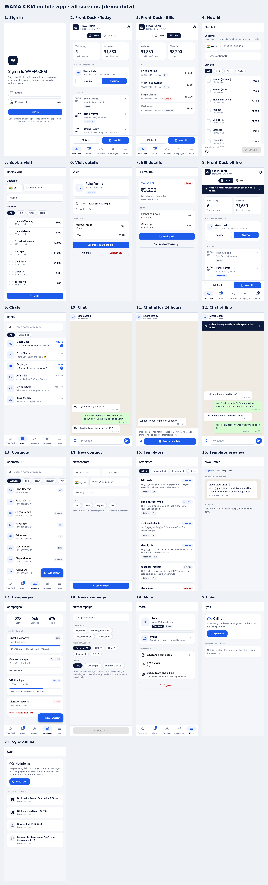

# WAMA CRM mobile (Flutter)

The phone app for WAMA CRM: **Front Desk** (today's visits, bills, bookings), **Chats**,
**Contacts**, **Templates** and **Campaigns**. It works **offline**: everything is kept on the
phone and changes sync on their own when the internet is back.



## Run it

```bash
flutter pub get

# Sample data, no account needed (the screens above)
flutter run --dart-define=DEMO=true

# Real workspace (values from your Supabase project; never commit them)
flutter run \
  --dart-define=API_BASE=https://wamacrm.magnetora.in \
  --dart-define=SUPABASE_URL=https://<project>.supabase.co \
  --dart-define=SUPABASE_ANON_KEY=<public anon key>
```

Release builds: `flutter build apk --release` (Android) or `flutter build ipa` (iOS, on a Mac),
with the same `--dart-define` values. Tests: `flutter test`. Checks: `flutter analyze`.

In demo mode on the web, `?screen=desk|bills|new_bill|new_booking|appointment|bill|chats|chat|chat_closed|contacts|new_contact|templates|template|campaigns|new_campaign|more|sync|login`
opens one screen, and `&offline=1` shows it with no internet and a few changes waiting.

## How offline works

- **Reading**: every list (Front Desk setup, today's visits, bills, contacts, chats and the latest
  10 conversations' messages, templates, campaigns) is saved on the phone (Hive). Screens always
  show the phone's copy and say how old it is when offline.
- **Changing**: bills, bookings, visit status, payments, contacts, messages and campaigns go into an
  **outbox** and show at once with "Waiting to sync". The outbox is sent **in order**: right away
  when online, every 30 seconds while something waits, and when the connection comes back.
- **Done once**: Front Desk actions carry a `client_ref`; the server remembers it
  (`salon_action_log`), so a bill sent twice (lost reply, retry) is billed once.
- **Made offline, changed offline**: a booking made offline gets a local id; marking it arrived
  later waits until the booking has synced, then uses the server's id.
- **Refused**: when the server says no (say, the time has passed), the change stops with the
  reason in **More → Sync**, with Try again and Discard.
- **WhatsApp's 24 hours**: when a customer has not written in 24 hours the chat offers an approved
  template instead of free text.

## Code map

- `lib/data/backend.dart`: HTTP to the web app's API with the Supabase session token.
- `lib/data/demo_backend.dart`: the same answers from sample data.
- `lib/data/local_store.dart`: the phone's copy and the outbox.
- `lib/data/app_state.dart`: loading, the outbox and syncing (the offline rules are written there).
- `lib/screens/*`: Front Desk, Chats, Contacts, Templates, Campaigns, More/Sync/Sign in.
- `lib/ui/theme.dart`: the WAMA colours (navy, one blue, greys; red only for attention).

Server endpoints it uses: `/api/mobile/me`, `/api/salon/setup|appointments|invoices|act`,
`/api/contacts`, `/api/conversations`, `/api/messages`, `/api/messages/send`,
`/api/whatsapp-templates`, `/api/campaigns`, `/api/campaigns/run`.
